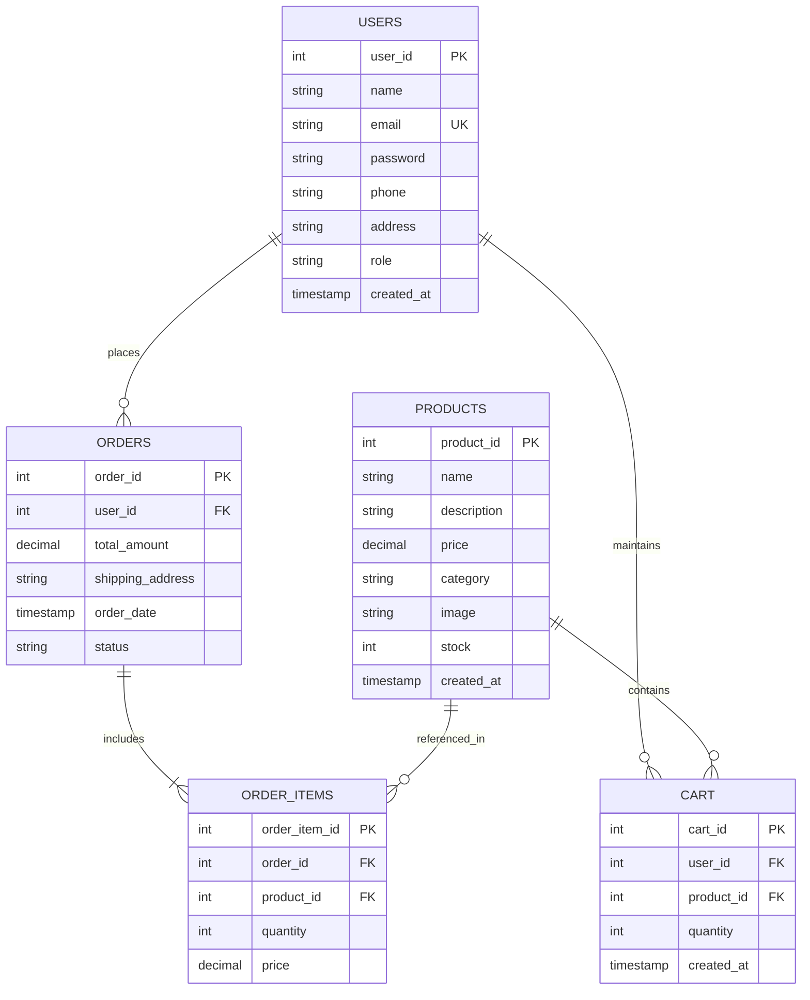

# Project Technical Documentation: Simple E-commerce Store

**Project Title:** Simple E-commerce Store (NovaStore)  
**Academic Level:** College Mini-Project / Web Application Development  
**Backend:** Python 3.12 / Flask  
**Frontend:** HTML5, CSS3, JavaScript (ES6), Bootstrap 5.3  
**Database:** SQLite 3 (Default) / MySQL Compatible  

---

## 1. Project Abstract & Objectives

### Abstract
The **Simple E-commerce Store** is a full-stack web application developed to provide a modern, reliable, and user-friendly online shopping platform. The system connects two primary stakeholders: **Customers**, who can register, browse products, utilize search and category filtering, manage an interactive shopping cart, and place orders with instant status tracking; and **Store Administrators**, who oversee inventory levels, adjust product pricing, fulfill customer orders, and inspect sales metrics via a centralized dashboard.

### Core Objectives
1. Implement a clean, responsive, and intuitive user interface using Bootstrap 5 and modern CSS aesthetics.
2. Establish a relational database schema supporting users, product catalogs, shopping carts, orders, and order item breakdowns.
3. Secure user credentials through cryptographic hashing (`werkzeug.security`) and enforce role-based access control (`customer` vs. `admin`).
4. Provide real-time inventory synchronization, preventing overselling beyond available stock.
5. Offer administrative controls for order status lifecycles (*Pending*, *Shipped*, *Delivered*, *Cancelled*).

---

## 2. Technology Stack & Architecture

| Tier | Technology | Rationale |
|---|---|---|
| **Presentation Tier (Frontend)** | HTML5, CSS3, JavaScript, Bootstrap 5.3, Bootstrap Icons | Provides cross-device mobile responsiveness, clean UI components, and client-side form validation without external heavy framework dependencies. |
| **Application Tier (Backend)** | Python 3.12, Flask 3.1, Werkzeug | Lightweight, fast execution, clean routing with decorators, robust session handling, and built-in templating with Jinja2. |
| **Data Tier (Database)** | SQLite 3 / MySQL | ACID-compliant relational data management. SQLite offers zero-configuration instant setup, while MySQL scripts provide seamless enterprise compatibility. |

### Architectural Model (Model-Template-View / MVC Pattern)
- **Model**: SQLite tables (`users`, `products`, `cart`, `orders`, `order_items`) accessed via Python `sqlite3` using parameterized queries.
- **View / Template**: Jinja2 HTML templates styled with custom CSS glassmorphism, responsive grids, and Bootstrap 5.
- **Controller**: Flask route handlers in `app.py` managing business logic, session verification, and data manipulation.

---

## 3. Entity-Relationship (ER) Diagram

---

## 4. Use Case Diagram

```mermaid
graph TD
    subgraph System Boundary: NovaStore
        UC1[Register & Create Account]
        UC2[Login & Authenticate]
        UC3[Browse Products & View Details]
        UC4[Search & Filter by Category]
        UC5[Add Products to Shopping Cart]
        UC6[Update Quantity / Remove Cart Items]
        UC7[Proceed to Checkout & Place Order]
        UC8[View Order History & Printable Invoice]
        UC9[Manage Profile & Address]

        UC10[Admin Login]
        UC11[View Analytics & Revenue Dashboard]
        UC12[Add / Edit / Delete Products]
        UC13[Update Inventory Stock & Price]
        UC14[View Customer Orders & Update Status]
        UC15[View Registered Customer Directory]
    end

    Customer((Customer)) --> UC1
    Customer --> UC2
    Customer --> UC3
    Customer --> UC4
    Customer --> UC5
    Customer --> UC6
    Customer --> UC7
    Customer --> UC8
    Customer --> UC9

    Admin((Store Admin)) --> UC10
    Admin --> UC11
    Admin --> UC12
    Admin --> UC13
    Admin --> UC14
    Admin --> UC15
```

---

## 5. Detailed Database Schema (Data Dictionary)

### Table 1: `users`
Stores registered customer accounts and administrative staff credentials.

| Column | Data Type | Constraints | Description |
|---|---|---|---|
| `user_id` | INTEGER | PRIMARY KEY, AUTOINCREMENT | Unique user identifier |
| `name` | VARCHAR(100) | NOT NULL | User's full name |
| `email` | VARCHAR(120) | NOT NULL, UNIQUE | User's login email address |
| `password` | VARCHAR(255) | NOT NULL | Salted & hashed password (PBKDF2-SHA256) |
| `phone` | VARCHAR(20) | NULL | Contact phone number |
| `address` | TEXT | NULL | Default shipping/delivery address |
| `role` | VARCHAR(20) | DEFAULT 'customer' | User privilege level (`customer` or `admin`) |
| `created_at`| TIMESTAMP | DEFAULT CURRENT_TIMESTAMP | Account creation date and time |

---

### Table 2: `products`
Stores items available for sale in the catalog.

| Column | Data Type | Constraints | Description |
|---|---|---|---|
| `product_id` | INTEGER | PRIMARY KEY, AUTOINCREMENT | Unique product identifier |
| `name` | VARCHAR(150) | NOT NULL | Product title/display name |
| `description`| TEXT | NULL | In-depth product specifications and details |
| `price` | REAL / DECIMAL(10,2)| NOT NULL | Selling unit price |
| `category` | VARCHAR(50) | NOT NULL | Category classification (Electronics, Fashion, etc.)|
| `image` | VARCHAR(255) | DEFAULT 'default_product.svg' | Image filename stored in `static/uploads/` |
| `stock` | INTEGER | NOT NULL, DEFAULT 0 | Real-time units in inventory |
| `created_at`| TIMESTAMP | DEFAULT CURRENT_TIMESTAMP | Date product was added to store |

---

### Table 3: `cart`
Maintains items actively selected by customers prior to order submission.

| Column | Data Type | Constraints | Description |
|---|---|---|---|
| `cart_id` | INTEGER | PRIMARY KEY, AUTOINCREMENT | Unique cart entry identifier |
| `user_id` | INTEGER | NOT NULL, FK -> `users(user_id)` ON DELETE CASCADE | Customer who owns the cart item |
| `product_id`| INTEGER | NOT NULL, FK -> `products(product_id)` ON DELETE CASCADE| Product selected |
| `quantity` | INTEGER | NOT NULL, DEFAULT 1 | Quantity requested |
| `created_at`| TIMESTAMP | DEFAULT CURRENT_TIMESTAMP | Timestamp item was added to cart |

---

### Table 4: `orders`
Stores confirmed customer orders and fulfillment status.

| Column | Data Type | Constraints | Description |
|---|---|---|---|
| `order_id` | INTEGER | PRIMARY KEY, AUTOINCREMENT | Unique order invoice number |
| `user_id` | INTEGER | NOT NULL, FK -> `users(user_id)` ON DELETE CASCADE | Customer who placed the order |
| `total_amount`| REAL / DECIMAL(10,2)| NOT NULL | Final charged amount (items + shipping) |
| `shipping_address`| TEXT | NOT NULL | Delivery address, recipient name, phone, payment method |
| `order_date`| TIMESTAMP | DEFAULT CURRENT_TIMESTAMP | Date and time order was placed |
| `status` | VARCHAR(30) | DEFAULT 'Pending' | Current status: `Pending`, `Shipped`, `Delivered`, `Cancelled` |

---

### Table 5: `order_items`
Stores the itemized snapshot of products included in each order.

| Column | Data Type | Constraints | Description |
|---|---|---|---|
| `order_item_id`| INTEGER | PRIMARY KEY, AUTOINCREMENT | Unique line-item identifier |
| `order_id` | INTEGER | NOT NULL, FK -> `orders(order_id)` ON DELETE CASCADE | Parent order reference |
| `product_id`| INTEGER | NOT NULL, FK -> `products(product_id)` | Product purchased |
| `quantity` | INTEGER | NOT NULL | Quantity purchased at time of order |
| `price` | REAL / DECIMAL(10,2)| NOT NULL | Unit price captured at time of purchase |

---

## 6. Functional Modules Description

### Module 1: Authentication & User Accounts
- **Registration**: Captures full user profile, checks for existing email to prevent duplicates, enforces password length standards, and encrypts passwords using `generate_password_hash`.
- **Login / Session**: Validates credentials against hashed passwords using `check_password_hash`. Creates an encrypted Flask session cookie storing `user_id`, `user_name`, and `role`.
- **Role Control**: Protects admin endpoints with the `@admin_required` decorator, blocking unauthorized customer access.

### Module 2: Catalog & Discovery
- **Product Listing**: Dynamically renders products into responsive cards with stock badges (*In Stock*, *Low Stock*, *Out of Stock*).
- **Search & Category Filters**: SQL queries using parameterized `LIKE` operators and category clauses allow real-time filtering without page reloading issues.
- **Sorting Engine**: Supports sorting by newest arrival, ascending price, descending price, and alphabetical order.

### Module 3: Shopping Cart
- **Cart Persistence**: Stored directly in the `cart` database table associated with the customer's `user_id`.
- **Dynamic Navbar Counter**: Injected into all pages via a Flask context processor (`inject_global_data`), ensuring real-time cart counts.
- **Quantity Management**: Allows customers to increase, decrease, or remove items. Automatically enforces inventory ceilings so customers cannot request more than available stock.

### Module 4: Checkout & Order Placement
- **Address Validation**: Pre-populates shipping information from the customer's profile while allowing changes.
- **Atomic Transaction**:
  1. Validates stock availability for every cart item.
  2. Inserts parent record into `orders`.
  3. Inserts each item into `order_items` with historical price capture.
  4. Automatically decrements inventory in `products`.
  5. Clears the user's `cart` records.

### Module 5: Order Confirmation & History
- **Printable Invoicing**: Formats a professional invoice receipt with an automatic `window.print()` trigger.
- **Customer History**: Displays collapsible accordions showing all past orders, line items, and color-coded status badges.

### Module 6: Administrator Portal
- **Dashboard**: Aggregates total store revenue, order volume, catalog size, low stock count, and active customer totals.
- **Product Management**: Provides full CRUD capabilities (Create, Read, Update, Delete) with image file uploading and stock level tracking.
- **Order Management**: Allows administrators to view all orders and transition status through `Pending` -> `Shipped` -> `Delivered` (or `Cancelled`).
- **Customer Directory**: Displays registered customer profiles, contact numbers, order frequency, and lifetime expenditure.

---

## 7. Security & Best Practices Implemented

1. **Password Hashing**: Passwords are never stored in plaintext. They are salted and hashed using PBKDF2-SHA256 via Werkzeug.
2. **SQL Injection Prevention**: All database interactions use SQLite parameterized queries (`?` placeholders), preventing malicious SQL input.
3. **Session Integrity**: Session cookies are cryptographically signed using a server-side secret key.
4. **Input Sanitization & File Upload Safety**: File uploads are secured using Werkzeug's `secure_filename` and restricted to whitelisted image extensions (`png`, `jpg`, `jpeg`, `webp`, `svg`).
5. **Foreign Key Integrity**: Foreign keys are enabled with `PRAGMA foreign_keys = ON;`, ensuring cascading deletes and data consistency across related tables.
6. **Graceful Error Handling**: Flash messages provide feedback for both success and failure cases (e.g., duplicate email, insufficient stock, invalid credentials).

---

## 8. Verification & Test Results

The application was validated using the automated test suite `test_workflow.py`. All tests completed successfully:

| Test # | Test Case Description | Expected Result | Status |
|---|---|---|---|
| TC-01 | Customer Login (`POST /login`) | User authenticated, session established | **PASSED** |
| TC-02 | Add to Cart (`POST /cart/add/2`) | Item added to `cart` table with quantity | **PASSED** |
| TC-03 | View Shopping Cart (`GET /cart`) | Cart items and subtotal calculated | **PASSED** |
| TC-04 | Checkout Order (`POST /checkout`) | Order and order items recorded, stock decremented | **PASSED** |
| TC-05 | Customer Orders History (`GET /orders`) | Past orders rendered with line-item details | **PASSED** |
| TC-06 | Customer Logout (`GET /logout`) | Session cleared, user redirected | **PASSED** |
| TC-07 | Admin Login (`POST /login`) | Admin authenticated with `admin` role | **PASSED** |
| TC-08 | Admin Dashboard (`GET /admin`) | KPI metrics and recent orders displayed | **PASSED** |
| TC-09 | Add Product (`POST /admin/products/add`) | New product persisted to database | **PASSED** |
| TC-10 | Customer Directory (`GET /admin/customers`) | Customer list and lifetime spend rendered | **PASSED** |
| TC-11 | Catalog Verification (`GET /admin/products`)| New product reflected in catalog inventory | **PASSED** |
| TC-12 | Update Order Status (`POST /admin/orders/...`)| Status updated to 'Shipped' in database | **PASSED** |

---

## 9. Conclusion
The **NovaStore Simple E-commerce Store** fulfills all requirements for a complete, academic-grade web application. It combines robust backend routing, secure database design, responsive modern front-end aesthetics, and complete administration workflows into an organized and easily deployable project package.
